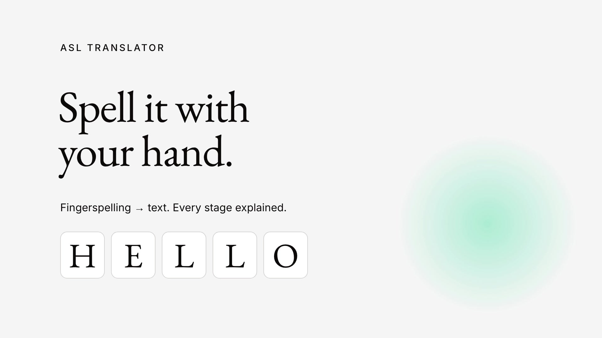

# ASL Translator launch video

[Download or watch the launch video](brag.mp4)

22 seconds · 1920×1080 · 30 fps · H.264 video with AAC audio.

The film follows the actual camera-free synthetic HELLO demo, with enlarged output and stage feedback, the app's editorial typography, music and subtle sound effects. The synthetic demo illustrates the application flow; it does not measure real-world recognition accuracy.

- [Poster / custom thumbnail](brag.jpg)
- [Share caption](share-copy.txt)
- [Credits and licensing](credits.txt)

Music: Happy Beats / Business Moves Vol. 1 by Sascha Ende, [ende.app](https://ende.app/en), licensed under [CC BY 4.0](https://ende.app/en/standard-license). The excerpt is shortened, with gain adjustments and fades. Retain the music credit with public shares. Sound effects: Kenney.nl, CC0.
